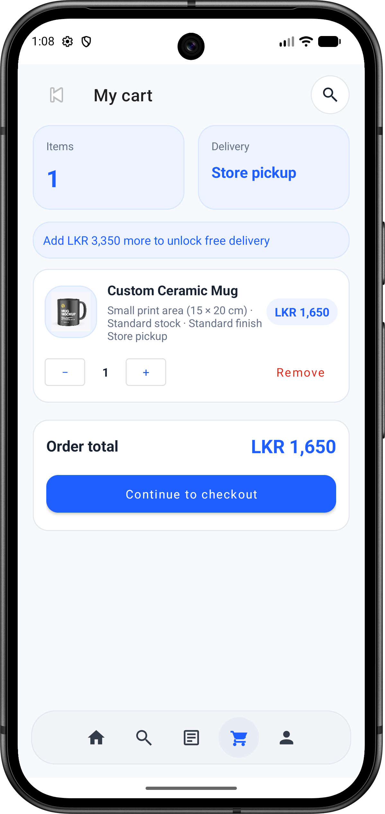
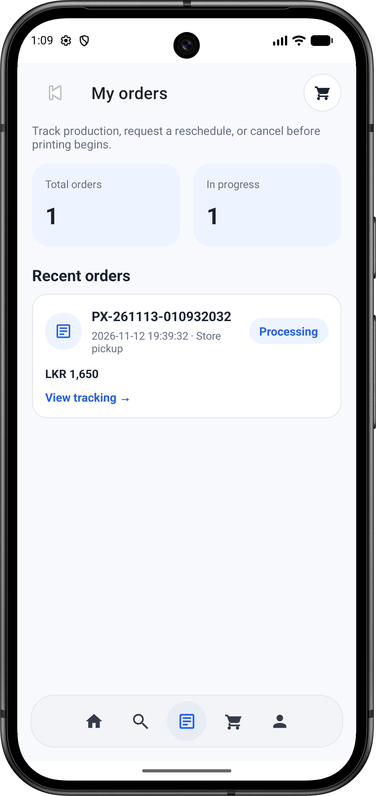

# PrintXpress — Digital Printing Service Android App


**PrintXpress** is a native Android application built for a digital printing service. It streamlines the process of submitting print requests, customizing print specifications (paper size, color mode, copies, binding), calculating instant pricing, and tracking order statuses using local SQLite persistence.

---

## Key Features

- **User Authentication & Profiles:** Secure customer registration, login, and profile management stored locally via SQLite.
- **Custom Print Order Configuration:** Select document types, page counts, paper sizes (A4, A3, Letter), color options (Black & White / Full Color), and finishing/binding preferences.
- **Dynamic Cost Calculation:** Real-time price estimation based on selected print specifications and copy quantities.
- **Order Management & Tracking:** View active orders, check order status updates, and browse past print order history.
- **Admin / Shop Management (if applicable):** Manage incoming print jobs, update order statuses, and configure service pricing.

---

## Tech Stack

| Category | Technology |
| :--- | :--- |
| **Language** | Java |
| **UI & Layouts** | XML, Material Design Components |
| **Local Database** | SQLite (`SQLiteOpenHelper`) |
| **Build System** | Gradle (v8.2)[cite: 1] |
| **IDE** | Android Studio |
| **Package Name** | `com.assignment.printxpress`[cite: 1] |

---

## Screenshots


| Login / Home Screen | New Print Order | Order History |
| :---: | :---: | :---: |
|  |  |  |

---

## Project Structure

```text
PrintXpress/
├── app/
│   ├── src/
│   │   ├── main/
│   │   │   ├── java/com/assignment/printxpress/   # Activities, Models, Adapters & DB Helpers
│   │   │   ├── res/                               # XML Layouts, Drawables, Strings & Themes
│   │   │   └── AndroidManifest.xml                # App Permissions & Activity Declarations
│   │   └── test/                                  # Local Unit Tests
│   └── build.gradle                               # Module-level dependencies & SDK config
├── gradle/wrapper/                                # Gradle Wrapper files
├── build.gradle                                   # Top-level Gradle configuration
├── settings.gradle                                # Project module includes
└── README.md                                      # Project documentation
